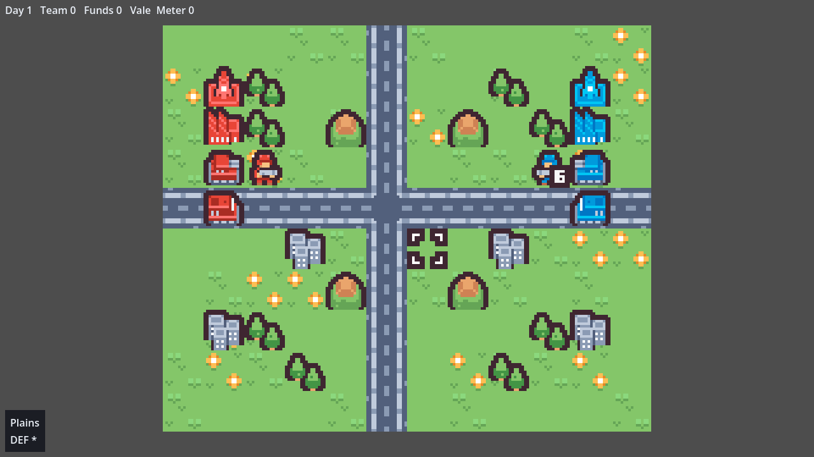
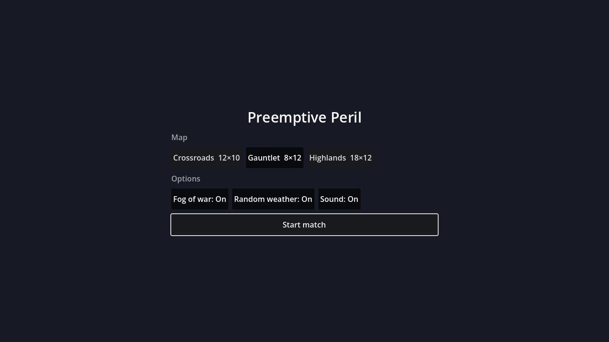
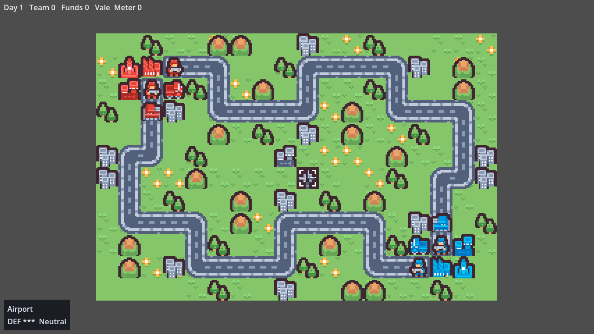
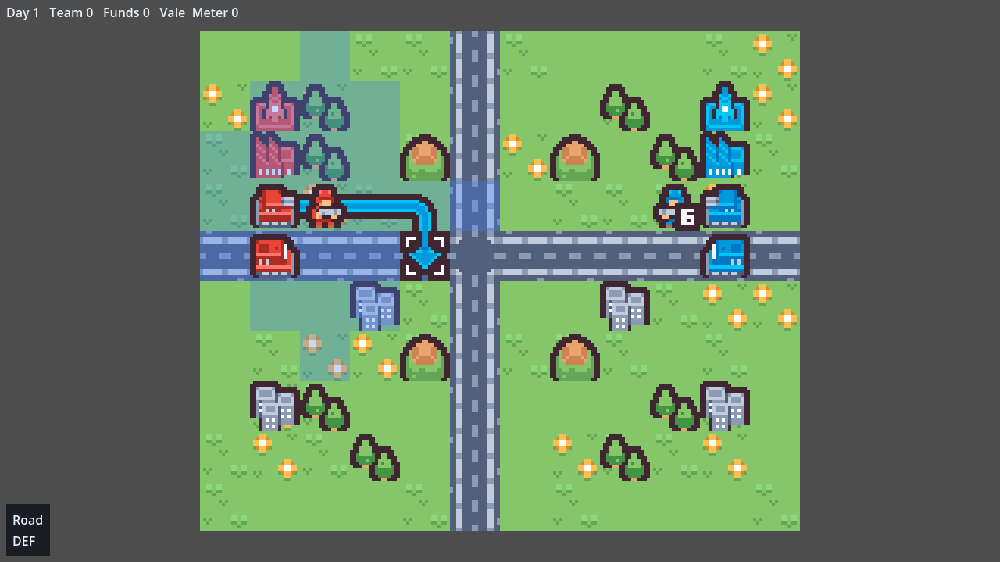

# Preemptive Peril

[](https://github.com/Quesadius/preemptive-peril/actions/workflows/ci.yml)

A turn-based grid tactics game built in Godot 4 with GDScript. Command an army of infantry, tanks, artillery, transports and aircraft, capture cities for income, build reinforcements at factories and airports, and take the enemy's headquarters before they take yours.

**Status:** playable against the computer on three maps, with optional fog of war and weather, autosave, pixel art from Kenney's Tiny Battle pack, and synthesized sound effects. There is no music yet.



## Running the game

**Play in your browser:** https://quesadius.github.io/preemptive-peril/ — rebuilt from `main` on every push. It works on computers, tablets and phones, in landscape or portrait.

To run it locally you need [Godot](https://godotengine.org/) 4.6 or newer (CI uses 4.7).

- **From the editor:** open `project.godot` and press **F5**.
- **From a terminal**, in the repository root:

  ```bash
  godot --path .
  ```

- **Straight into a battle**, skipping the menu (add `++ demo` for the small code-built demo map):

  ```bash
  godot --path . -s tools/preview_battle.gd
  ```

## Starting a match



The game opens on the new-match screen. Pick a map, switch **fog of war**, **random weather** and **sound** on or off, and start; your choices are remembered. Arrow keys and Enter, the mouse, and touch all work here.

| Map | Size | Notes |
|---|---|---|
| Crossroads | 12×10 | The original: two bases either side of a road junction |
| Gauntlet | 8×12 | Tall and narrow, sized to fit a phone held upright |
| Highlands | 18×12 | The big one, with an airport in each base and two more to fight over |



The match is **saved after every action**. Close the game — or the browser tab — and the new-match screen offers **Continue** next time. To leave a match yourself, confirm on any empty tile and choose **Quit to menu**.

## How to play

You command red (CO Vale). The computer commands blue (CO Rook) and plays its turn automatically after you end yours.



*Moving a unit: the shaded tiles are its range and the arrow is the route you've traced. The blue infantry's "6" badge shows a damaged unit's HP; full-strength units show no badge.*

| Key | Action |
|---|---|
| Arrow keys | Move the cursor; while choosing a target, cycle between targets |
| Enter / Space | Confirm |
| Esc | Back out one step |
| D | Show or hide the enemy danger map |
| + / − or mouse wheel | Zoom |

| Mouse or touch | Action |
|---|---|
| Hover | Move the cursor (and trace a route while a unit is selected) |
| Click, or tap twice | Confirm on that tile. On touch the first tap aims the cursor, the second confirms |
| Click a menu row | Choose it |
| Right-click | Back out one step |
| Click outside a unit's range, off the targets while aiming, or away from a menu | Back out of it |
| Drag | Pan the map |
| Pinch | Zoom in and out around your fingers |
| **Back** / **Danger** buttons | On touchscreens, stand in for Esc and D |

What confirming (**Enter** or a click) does depends on what is under the cursor:

- **One of your units** shows where it can move (blue). Trace a route with the cursor, then confirm a destination to open its orders: Wait, Attack, Capture, Load, Unload, Supply or Join, whichever apply there. Attacking snaps the cursor to a target and shows the damage forecast. A unit turns grey once it has acted.
- **An enemy unit** shows where it can move (blue) and everything it could hit next turn (red).
- **An empty factory or airport you own** opens the build menu.
- **Any other empty tile** opens the system menu: **End Turn**, **Quit to menu**, plus your CO power once its meter is full.

**Economy and capture.** Each property you own pays 1,000 funds at the start of your turn, and your units standing on your properties are repaired and resupplied. Infantry and mechs capture cities, factories and HQs. A property needs 20 capture points, and each turn adds the capturing unit's displayed HP, so healthy units capture faster.

**Aircraft.** Airports build Copters and Bombers. Flying units cross any terrain at full speed and get no defence from it, forests can't hide them, and they burn fuel every turn — land on an airport you own to refuel, because an aircraft that starts its turn with an empty tank crashes. Copters hunt vehicles and infantry; Bombers flatten anything on the ground but can't touch other aircraft. Anti-Air is the answer to both.

**Fog and weather.** Under fog of war you see only what your units and properties can see; forests hide ground units until you're next to them, and moving into an unseen enemy springs an ambush that ends the move. Random weather brings spells of rain or snow that slow movement.

**Winning.** Each side has an HQ, the spired building in its home base. Capture the enemy HQ and you win on the spot. A player is also eliminated when they have no units left and nowhere to build more. When the match ends, a Victory or Defeat message appears; press **Enter** or click to go back to the new-match screen.

## Development

The project follows a strict split between rules and presentation:

```
input -> Action -> Rules.validate() -> Rules.apply() -> Array[GameEvent] -> animation
```

- `core/`, `ai/` and `data/` are **pure**: no nodes, signals, scenes or rendering, so the whole game runs headless. A purity check enforces this.
- `ActionGenerator` is the single source of what is legal. The UI menus and the AI both use it.
- The game is **deterministic**. All randomness comes from one seeded generator in the game state, so a save is just the starting setup plus the list of actions, and replaying it reproduces the match exactly.
- Balance values live in `.tres` resources under `data/`, not in code.

| Directory | Contents |
|---|---|
| `core/` | Game state, actions, events, and the rules modules (movement, combat, fog, economy, …) |
| `ai/` | The computer opponent and its scoring maps |
| `data/` | Resource schemas plus the unit, terrain, CO, ruleset and map data |
| `persistence/` | JSON saves, deterministic replay, the map catalog |
| `presentation/`, `ui/` | Rendering, input, animation, sound synthesis, HUD, menus and the new-match screen |
| `autoload/` | Settings, audio and scene routing |
| `assets/` | The art pack: sprite sheet plus the file mapping it to terrain and units |
| `tools/` | Test runner, purity check, map-editing helpers, sprite generator, preview boot script |
| `tests/` | gdUnit4 tests, mirroring `core/` |
| `docs/` | Architecture outline, Godot notes, exporting guide |

[`docs/architecture.md`](docs/architecture.md) is the authoritative design document.

### Running the tests

```bash
./tools/run_tests.sh
```

This runs the purity check, `gdlint`, a parse check of every script, and the full gdUnit4 suite headless. gdUnit4 is included under `addons/`. Linting needs [gdtoolkit](https://github.com/Scony/godot-gdscript-toolkit):

```bash
pip install "gdtoolkit==4.*"
```

If `godot` isn't on your `PATH`, point the script at it with `GODOT_BIN=/path/to/godot`. CI runs the same script on every push, then builds Linux, Windows and Web exports. See [`docs/exporting.md`](docs/exporting.md) for exporting locally.

## License

Preemptive Peril is released under the [MIT License](LICENSE), copyright Quesadius. The bundled [gdUnit4](addons/gdUnit4) test framework keeps its own MIT license.

Art: [Tiny Battle](https://kenney.nl/assets/tiny-battle) by [Kenney](https://www.kenney.nl), released under [CC0](assets/tiny_battle/License.txt). The Medium Tank and Rockets sprites are this project's own edits of the pack's tank and truck, generated by [`tools/art/extend_tiny_battle.gd`](tools/art/extend_tiny_battle.gd).

Sound effects are synthesized in code ([`presentation/sfx_synth.gd`](presentation/sfx_synth.gd)); there are no audio files.
