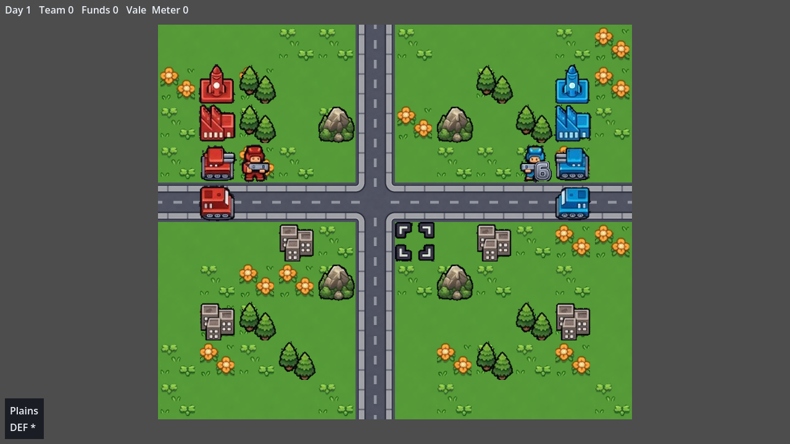
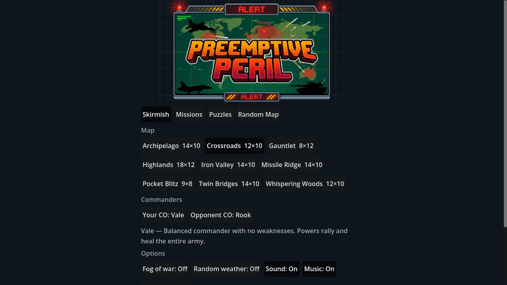
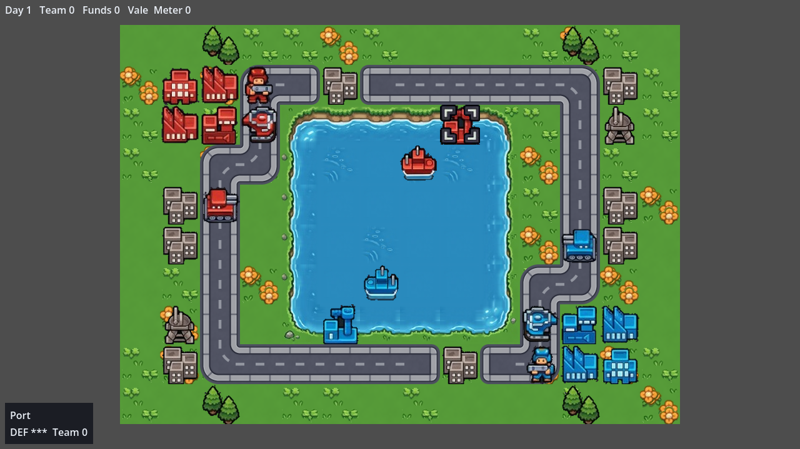
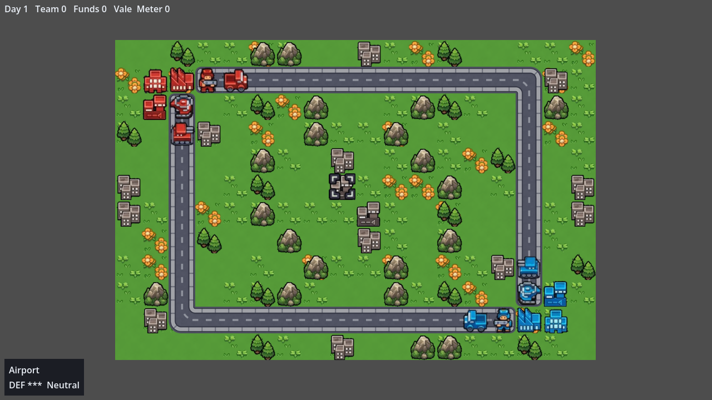
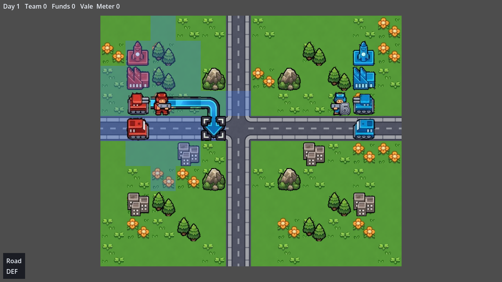

# Preemptive Peril

[](https://github.com/Quesadius/preemptive-peril/actions/workflows/ci.yml)

A turn-based grid tactics game built in Godot 4 with GDScript. Command an army of infantry, tanks, artillery, transports and aircraft, capture cities for income, build reinforcements at factories and airports, and take the enemy's headquarters before they take yours.

**Status:** playable against the computer or in 2-player hotseat across **9 handcrafted maps**, a **seeded random map generator**, **6 campaign missions**, and **4 tactical puzzles**, with **7 distinct commanders**, naval warfare (Ports, Landers, Cruisers, Battleships), Missile Silos, Comms Towers, Rivers & Bridges, Fog of War, weather, S/A/B/C match rankings, HD art, synthesized sound effects, and synthesized tactical music.



## Running the game

**Play in your browser:** https://quesadius.github.io/preemptive-peril/ — rebuilt from `main` on every push. It works on computers, tablets and phones, in landscape or portrait.

To run it locally you need [Godot](https://godotengine.org/) 4.6 or newer (CI uses 4.7).

- **From the editor:** open `project.godot` and press **F5**.
- **From a terminal**, in the repository root:

  ```bash
  godot --path .
  ```

- **Straight into a battle**, skipping the menu (add `++ demo` for the small code-built demo map):

  ```bash
  godot --path . -s tools/preview_battle.gd
  ```

## Starting a match



The game opens on the new-match screen. Pick a map, switch **fog of war**, **random weather** and **sound** on or off, set the balance, and start; your choices are remembered. Arrow keys and Enter, the mouse, and touch all work here.

| Map | Size | Notes |
|---|---|---|
| Archipelago | 14×10 | Coastal Ports, Cruisers, bridges, and a central Comms Tower island |
| Crossroads | 12×10 | The original: two bases either side of a road junction |
| Gauntlet | 8×12 | Tall and narrow, sized to fit a phone held upright |
| Highlands | 18×12 | Wide highway map with an airport in each base and two more to fight over |
| Iron Valley | 14×10 | Central mountain spine with flanking passes, Airports, and Attack Choppers |
| Missile Ridge | 14×10 | Race to seize two central Missile Silos and Comms Towers |
| Pocket Blitz | 9×8 | Compact 5-minute skirmish with fast armored clashes |
| Twin Bridges | 14×10 | River divide with two bridge choke points and artillery hills |
| Whispering Woods | 12×10 | Forest ambush lanes built for Recons and Fog of War |

You can also switch tabs on the setup screen to play **6 Campaign Missions**, **4 Tactical Puzzles** (1-turn challenges), or generate a seeded **Random Map** (Open Plains, River Crossing, Mountain Pass, or Coastal Sea).



### Commanders (COs)

Choose your commander and opponent commander on the setup screen:

| Commander | Specialty | Power / Super Power |
|---|---|---|
| Vale | Balanced all-rounder | Rally (+10% ATK/DEF) / Grand Rally (+20% ATK/DEF, +2 HP heal) |
| Rook | +10% passive defense | Bulwark (+30% DEF) / Citadel (+40% DEF, +1 HP heal) |
| Blitz | +15% direct ATK, −10% indirects | Overdrive (+1 move) / Lightning Strike (+2 move & **refreshes acted units**) |
| Nova | +25% indirect ATK, −10% direct | Barrage (+1 indirect range) / Firestorm (+2 indirect range, +35% ATK) |
| Aero | +20% air ATK, half air fuel burn | Tailwind (+1 move) / Air Superiority (+2 move, +30% ATK, +1 HP heal) |
| Midas | Units cost 15% less, −10% ATK | War Chest (+50% income burst) / Golden Surge (+100% income burst) |
| Shade | +1 fog vision, ignores weather, +5% cover/star | Ghost Walk (+1 move, +2 vision) / Shadow Ops (+3 vision, +25% ATK, +10% luck) |



### Difficulty and starting funds

The three buttons under **Balance** each step to their next choice when pressed.

| Difficulty | What changes |
|---|---|
| Easy | The computer earns a third less from its properties, doesn't guard its HQ, doesn't build counters to your units, and waits for you to come to it |
| Normal | An even fight: same income as you, and everything the computer knows how to do |
| Hard | The computer plays as on Normal and earns 50% more from its properties |

**Your funds** and **Enemy funds** set what each side starts with — 0, 5,000 or 10,000 — separately, so you can give yourself a head start, give the computer one, or both. Head starts stack with the difficulty: Easy with 10,000 for you is the gentlest match, Hard with 10,000 for the enemy the roughest.

The match is **saved after every action**. Close the game — or the browser tab — and the new-match screen offers **Continue** next time. To leave a match yourself, confirm on any empty tile and choose **Quit to menu**.

## How to play

You command red (CO Vale). The computer commands blue (CO Rook) and plays its turn automatically after you end yours.



*Moving a unit: the shaded tiles are its range and the arrow is the route you've traced. The blue infantry's "6" badge shows a damaged unit's HP; full-strength units show no badge.*

| Key | Action |
|---|---|
| Arrow keys | Move the cursor; while choosing a target, cycle between targets |
| Enter / Space | Confirm |
| Esc | Back out one step |
| Tab | Jump to next idle unit |
| Z | Undo last non-destructive wait move |
| D | Show or hide the enemy danger map |
| + / − or mouse wheel | Zoom |

| Mouse or touch | Action |
|---|---|
| Hover | Move the cursor (and trace a route while a unit is selected) |
| Click, or tap twice | Confirm on that tile. On touch the first tap aims the cursor, the second confirms |
| Click a menu row | Choose it |
| Right-click | Back out one step |
| Click outside a unit's range, off the targets while aiming, or away from a menu | Back out of it |
| Drag | Pan the map |
| Pinch | Zoom in and out around your fingers |
| **Back** / **Danger** buttons | On touchscreens, stand in for Esc and D |

What confirming (**Enter** or a click) does depends on what is under the cursor:

- **One of your units** shows where it can move (blue). Trace a route with the cursor, then confirm a destination to open its orders: Wait, Attack, Capture, Load, Unload, Supply or Join, whichever apply there. Attacking snaps the cursor to a target and shows the damage forecast. A unit turns grey once it has acted.
- **An enemy unit** shows where it can move (blue) and everything it could hit next turn (red).
- **An empty factory or airport you own** opens the build menu.
- **Any other empty tile** opens the system menu: **End Turn**, **Quit to menu**, plus your CO power once its meter is full.

**Economy and capture.** Each property you own pays 1,000 funds at the start of your turn, and your units standing on your properties are repaired and resupplied. Infantry and mechs capture cities, factories and HQs. A property needs 20 capture points, and each turn adds the capturing unit's displayed HP, so healthy units capture faster.

**Aircraft & Naval.** Airports build Attack Choppers and Bombers; Ports build Landers (carry 2 ground units across sea), Cruisers (anti-air and anti-ship escorts), and Battleships (long-range 2–6 indirect naval artillery). Flying and naval units burn fuel every turn and refuel at owned Airports/Ports.

**Comms Towers & Missile Silos.** Each Comms Tower you own adds +10% global attack to your entire army. Moving an Infantry or Mech onto an unspent Missile Silo lets you **Launch** a one-time tactical warhead onto any 3×3 diamond on the board, dealing 3 HP non-lethal splash damage to every unit caught in the blast.

**Winning.** Each side has an HQ (the grand command building in its home base). Capture the enemy HQ or eliminate all enemy units and production to win. Victories are graded **S / A / B / C** across Speed, Power, and Technique and saved per map, mission, and puzzle.

## Development

The project follows a strict split between rules and presentation:

```
input -> Action -> Rules.validate() -> Rules.apply() -> Array[GameEvent] -> animation
```

- `core/`, `ai/` and `data/` are **pure**: no nodes, signals, scenes or rendering, so the whole game runs headless. A purity check enforces this.
- `ActionGenerator` is the single source of what is legal. The UI menus and the AI both use it.
- The game is **deterministic**. All randomness comes from one seeded generator in the game state, so a save is just the starting setup plus the list of actions, and replaying it reproduces the match exactly.
- Balance values live in `.tres` resources under `data/`, not in code.

| Directory | Contents |
|---|---|
| `core/` | Game state, actions, events, and the rules modules (movement, combat, fog, economy, …) |
| `ai/` | The computer opponent and its scoring maps |
| `data/` | Resource schemas plus the unit, terrain, CO, ruleset and map data |
| `persistence/` | JSON saves, deterministic replay, the map catalog |
| `presentation/`, `ui/` | Rendering, input, animation, sound synthesis, HUD, menus and the new-match screen |
| `autoload/` | Settings, audio and scene routing |
| `assets/` | The art pack: sprite sheet plus the file mapping it to terrain and units |
| `tools/` | Test runner, purity check, map-editing helpers, sprite generator, preview boot script |
| `tests/` | gdUnit4 tests, mirroring `core/` |
| `docs/` | Architecture outline, Godot notes, exporting guide |

[`docs/architecture.md`](docs/architecture.md) is the authoritative design document.

### Running the tests

```bash
./tools/run_tests.sh
```

This runs the purity check, `gdlint`, a parse check of every script, and the full gdUnit4 suite headless. gdUnit4 is included under `addons/`. Linting needs [gdtoolkit](https://github.com/Scony/godot-gdscript-toolkit):

```bash
pip install "gdtoolkit==4.*"
```

If `godot` isn't on your `PATH`, point the script at it with `GODOT_BIN=/path/to/godot`. CI runs the same script on every push, then builds Linux, Windows and Web exports. See [`docs/exporting.md`](docs/exporting.md) for exporting locally.

## License

Preemptive Peril is released under the [MIT License](LICENSE), copyright Quesadius. The bundled [gdUnit4](addons/gdUnit4) test framework keeps its own MIT license.

Art: [Tiny Battle](https://kenney.nl/assets/tiny-battle) by [Kenney](https://www.kenney.nl), released under [CC0](assets/tiny_battle/License.txt). The Medium Tank and Rockets sprites are this project's own edits of the pack's tank and truck, generated by [`tools/art/extend_tiny_battle.gd`](tools/art/extend_tiny_battle.gd).

Sound effects are synthesized in code ([`presentation/sfx_synth.gd`](presentation/sfx_synth.gd)); there are no audio files.
